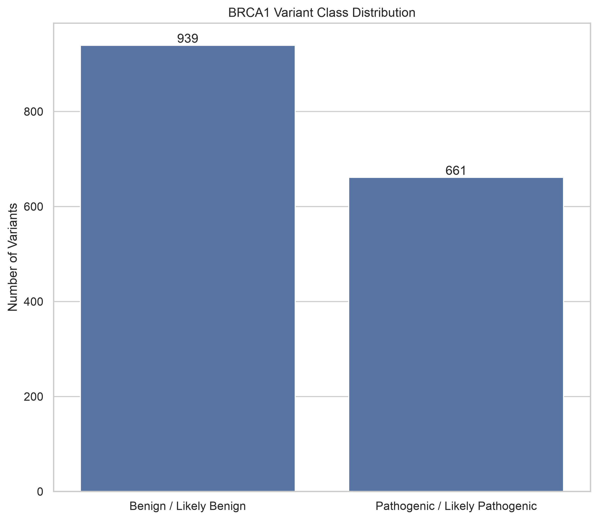
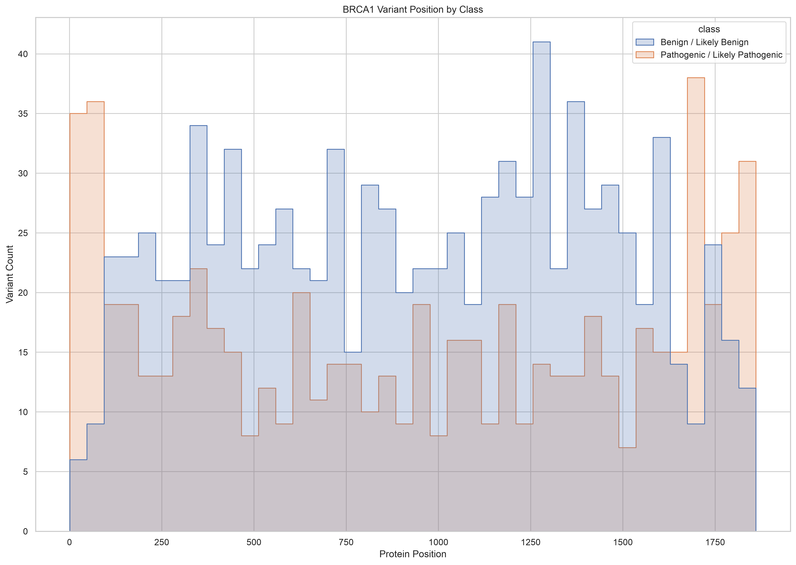
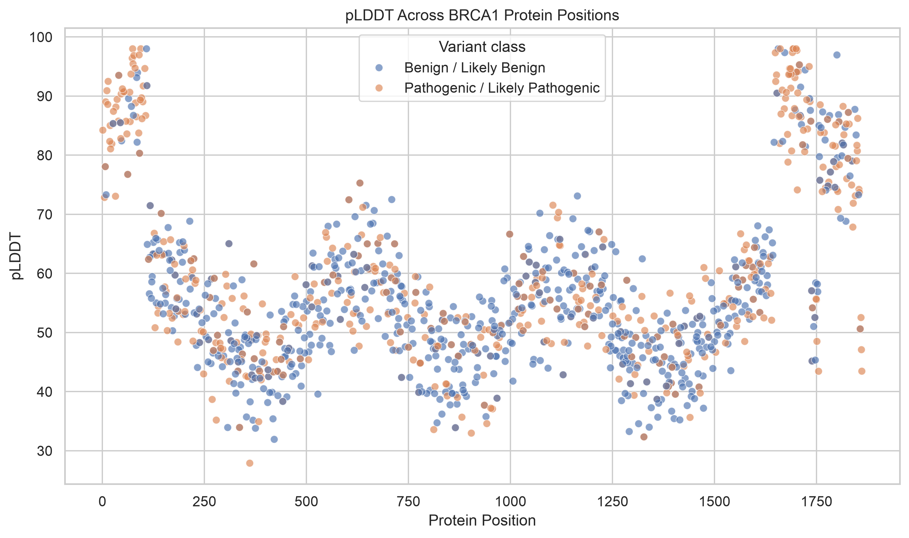
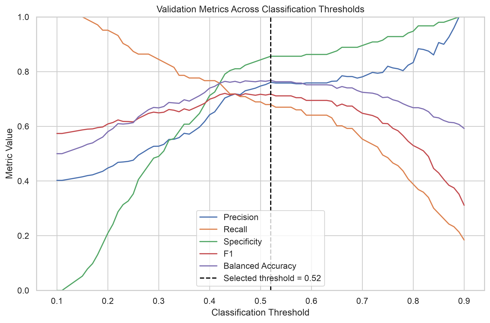
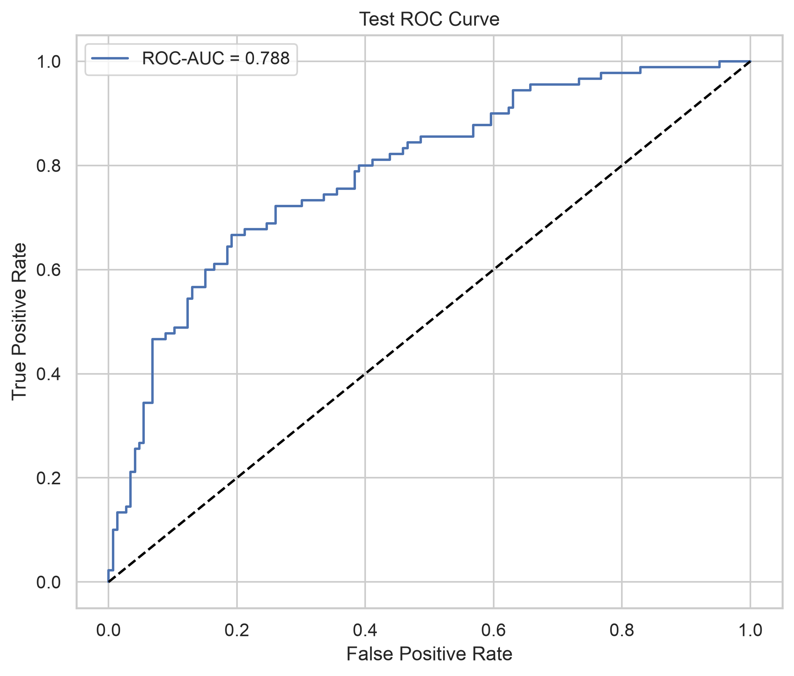
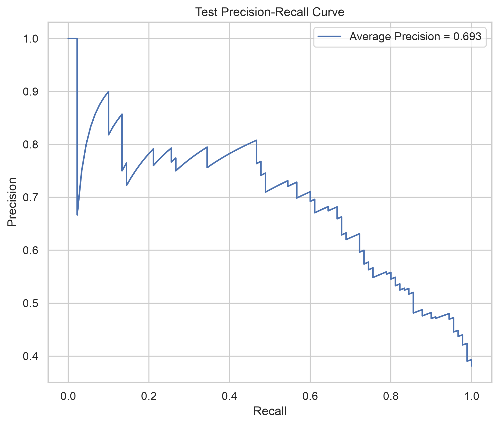
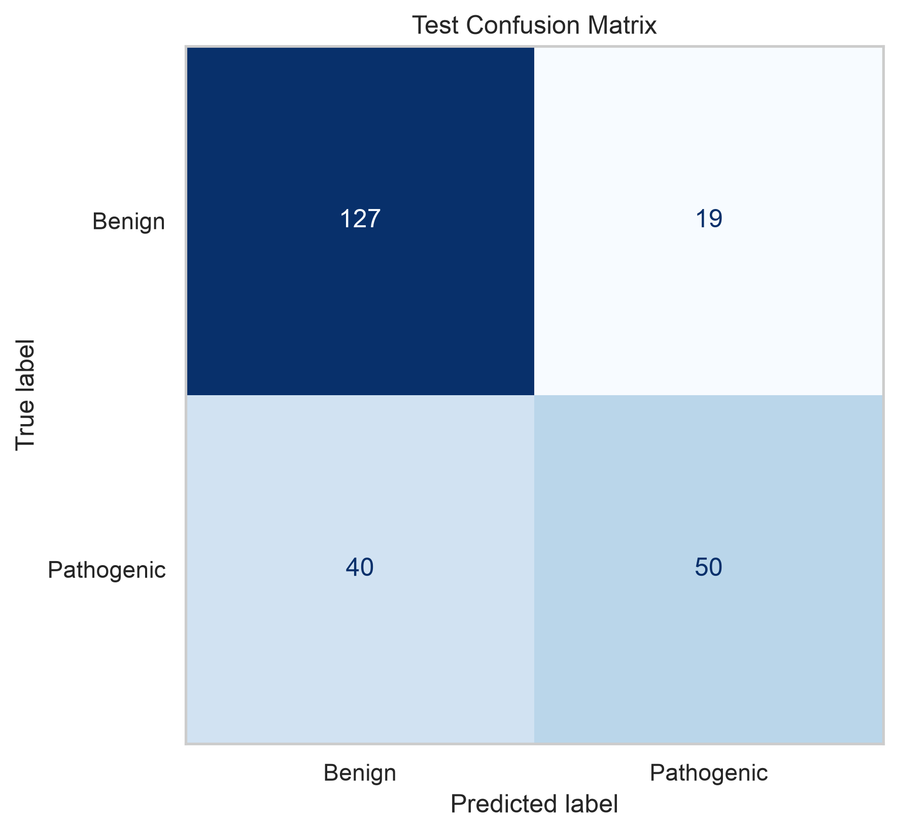
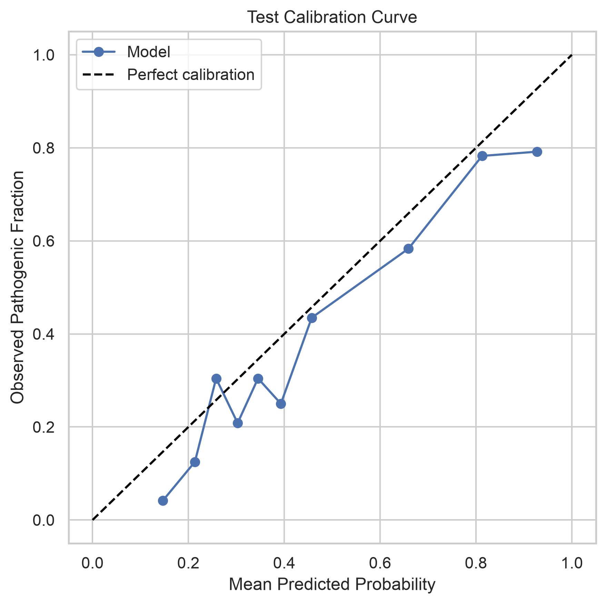
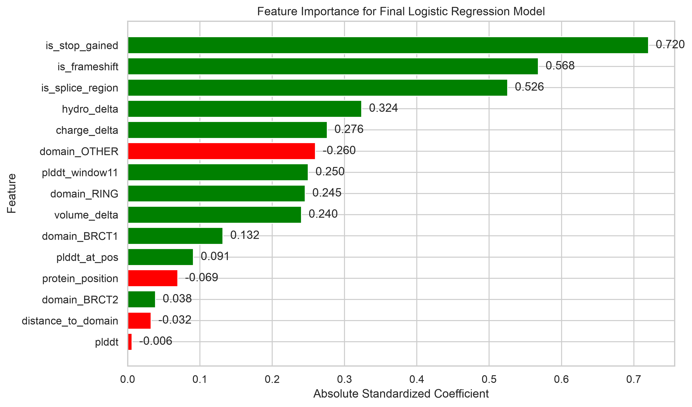
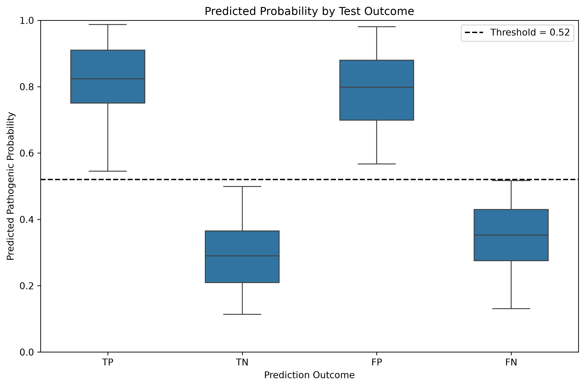

<h1 style="font-size: 27px; margin-bottom: 16px;">BRCA1 Mutation Risk Prediction Using Structural and Sequence-Derived Features</h1>

*Author:* **Mohit Kukreja** 
*Email:* mohitkukreja0297@gmail.com 
*Repository:* [BRCA1-Risk_Prediction](https://github.com/mohit-kukrejaa/brca1-risk-prediction.git)

An end-to-end machine learning pipeline designed to predict BRCA1 mutation risk using structural, positional, biochemical, and sequence-derived features. 

## 1. Problem Statement

BRCA1 variants can have different levels of clinical significance, ranging from benign changes to variants associated with increased disease risk. The goal of this project was to evaluate whether structural and sequence-derived features can be used to distinguish pathogenic BRCA1 variants from benign variants.

The problem was formulated as a binary classification task:

- **Positive class (1):** Pathogenic and Likely Pathogenic
- **Negative class (0):** Benign and Likely Benign

Variants classified as Variant of Uncertain Significance (VUS), Conflicting Interpretations, or Not Provided were excluded from the modeling dataset.

The main question answered through this project is whether information such as protein position, BRCA1 functional domain, structural confidence, amino-acid substitution properties, and variant consequence can provide enough information to predict pathogenicity.

The model is not intended to replace clinical variant interpretation or expert review. It is just for research purpose.

## 2. Data Sources and Preprocessing

### 2.1 Dataset Overview

The analysis used the BRCA1 variant dataset provided. No external datasets were added to the main modeling pipeline.

The dataset contained **1,600 BRCA1 variants** and **24 columns** consisting of a combination of variant metadata, protein position & sequence information, structural features, functional domain information, and clinical significance labels.

The dataset included features such as:

- protein position
- reference and alternate amino acid (`ref_aa`, `alt_aa`)
- BRCA1 functional domain
- distance from a functional domain
- pLDDT structural confidence scores
- local pLDDT measurements
- amino-acid property changes
- variant consequence indicators (stop-gain, frameshift, and splice-region variants)

The clinical significance column was used to construct the binary target variable.

<table class="summary-grid">
<tr>
<td width="55%" valign="top">
 

<b>Table 1. Dataset Summary</b>

 

<table class="data-table">
<tr><th>Item</th><th>Value</th></tr>
<tr><td>Total variants</td><td>1,600</td></tr>
<tr><td>Benign / Likely Benign</td><td>939</td></tr>
<tr><td>Pathogenic / Likely Pathogenic</td><td>661</td></tr>
<tr><td>Original columns</td><td>24</td></tr>
<tr><td>Gene</td><td>BRCA1</td></tr>
</table>
</td>

<td width="45%" align="center" valign="top">

<em>Figure 1. Clinical significance distribution.</em>

</td>
</tr>
</table>

The resulting dataset had a moderate class imbalance, with approximately **58.7% benign variants** and **41.3% pathogenic variants**.

### 2.2 Label Preparation

Clinical significance was converted into a binary target:

| Clinical Significance | Target |
|---|---:|
| Benign | 0 |
| Likely Benign | 0 |
| Pathogenic | 1 |
| Likely Pathogenic | 1 |

This allowed the task to be treated as a supervised binary classification problem.

### 2.3 Data Validation

Before model training, basic validation checks were performed for missing values, duplicate variation IDs, amino-acid validity, identical reference/alternate residues, domain consistency, and repeated protein positions.

All amino-acid substitutions were checked against the standard 20 amino acids, and no cases were found where the reference and alternate amino acids were identical. `variation_id` was unique, and no invalid or identical amino-acid substitutions were found. Repeated protein positions were retained because they represented distinct variants. This became important when defining the train, validation, and test sets.

### 2.4 Train, Validation, and Test Split

The dataset was split into training, validation, and test sets using approximately a **70/15/15 split**. Instead of using a random split, variants were grouped by `protein_position`. This prevents variants occurring at the same protein position from appearing in multiple data splits, and hence prevents data leakage. This was important because certain features, including domain information and structural confidence measurements, are strongly related to protein position. Allowing the same position to appear in both train and test data could make the evaluation overly optimistic.

<b>Table 2. Dataset Split</b>

| Split | Total Variants | Pathogenic | Pathogenic % |
|---|---:|---:|---:|
| Training | 1,108 | 468 | 42.2% |
| Validation | 256 | 103 | 40.2% |
| Test | 236 | 90 | 38.1% |

There was no overlap in protein positions between the training, validation, and test sets. The test set was kept separate from model training and hyperparameter selection and was used only for final evaluation.

## 3. Exploratory Data Analysis

Exploratory analysis was performed to understand how pathogenic and benign variants were distributed across BRCA1 and to identify patterns in the structural and sequence-derived features before model training.

### 3.1 Variant Position by Class

Some regions showed a greater concentration of pathogenic variants. This observation also motivated grouping the train, validation, and test split by `protein_position` so that variants from the same position would not appear across multiple datasets.

### 3.2 Structural Confidence Across BRCA1

The pLDDT values were also studied across protein positions. Structural confidence varied across the BRCA1 sequence. Since pLDDT represents confidence in the predicted protein structure rather than pathogenicity itself, it was treated as one source of structural information and combined with positional, biochemical, and functional features during modeling.

<table class="figure-grid">
<tr>

<td width="45%" align="center" valign="top">

 
<em>Figure 2. BRCA1 variant positions by class.</em>

</td>

<td width="55%" align="center" valign="top">

 
<em>Figure 3. pLDDT across BRCA1 protein positions.</em>

</td>

</tr>
</table>

<h2>4. Feature Engineering</h2>

The original dataset already contained positional, structural, biochemical,
domain, and consequence-related features. Additional features were created
to capture interactions between amino-acid changes, structural confidence,
and functional domain context.

### 4.1 Engineered Features

The following features were derived from the raw variables:

| Engineered Feature | Definition / Purpose |
|---|---|
| `plddt_delta` | `plddt_at_pos - plddt_window11` |
| `plddt_neighbor_delta` | Difference between variant-position pLDDT and surrounding residues |
| `blosum62_score` | Substitution compatibility based on BLOSUM62 |
| `grantham_distance` | Physicochemical distance between reference and alternate amino acids |
| `hydro_signed_delta` | Direction of hydrophobicity change |
| `volume_signed_delta` | Direction of residue-volume change |
| `in_functional_domain` | Indicates whether the variant occurs in RING, BRCT1, or BRCT2 |
| `grantham_plddt` | `grantham_distance × plddt_at_pos` |
| `blosum_plddt` | `blosum62_score × plddt_at_pos` |
| `blosum_unfavorable_plddt` | `max(0, -blosum62_score) × plddt_at_pos` |
| `grantham_domain` | `grantham_distance × in_functional_domain` |

### 4.2 Feature Set Experiments

Three feature configurations were compared during training:

| Experiment | Description |
|---|---|
| Base | Original model features |
| Base + Engineered | Base features plus engineered features |
| Model Selected | Base + engineered features followed by model-based feature selection |

This allowed the impact of feature engineering to be evaluated rather than assuming that additional features would always improve model performance.

## 5. Modeling and Validation Strategy

Three classification models were compared: **Logistic Regression, Random Forest, and XGBoost**. Logistic Regression provided an interpretable linear baseline, while Random Forest and XGBoost were included to test whether nonlinear relationships improved performance.

Model tuning was performed using **5-fold Stratified Group Cross-Validation**, grouped by `protein_position`. This maintained similar class proportions across folds while preventing variants from the same protein position from appearing in both training and validation folds.

**Average Precision (AP)** was used as the primary model-selection metric because the dataset was moderately imbalanced and precision-recall performance was more informative than accuracy alone. ROC-AUC and Balanced Accuracy were tracked as secondary metrics.

### 5.1 Hyperparameter Tuning

Grid search was used for Logistic Regression, while randomized search was used for Random Forest and XGBoost. Hyperparameters were tuned separately for each model.

| Model | Main Parameters Tuned |
|---|---|
| Logistic Regression | regularization, class weight |
| Random Forest | number of trees, max depth, min leaf size, feature sampling, class weight |
| XGBoost | number of trees, tree depth, learning rate, subsampling, regularization |

Each model was evaluated using the three feature configurations: (1) Base, (2) Base plus Engineered, and (3) Model Selected. The best feature configuration for each model was selected using cross-validation Average Precision.

### 5.2 Validation Model Comparison

After hyperparameter tuning, the best version of each model was evaluated on the fixed validation set.

| Model | Feature Set | CV AP | Validation AP |
|---|---|---:|---:|
| Logistic Regression | Base | 77.9 % | 77.8 % |
| Random Forest | Base | 74.1 % | 72.4 % |
| XGBoost | Model selected | 75.6 % | 74.8 % |

Logistic Regression was selected as the final model because it achieved the strongest validation performance and also provided directly interpretable feature coefficients. The selected model was then frozen before threshold selection and final test evaluation.

## 6. Class Imbalance and Threshold Selection

The dataset had a moderate class imbalance, with **58.7% benign** and **41.3% pathogenic** variants. Because the imbalance was not extreme, SMOTE was not used. Instead, class weighting was evaluated as part of model tuning.

The default threshold of 0.50 was not assumed to be optimal. Thresholds from **0.10 to 0.90** were evaluated on the validation set using precision, recall, specificity, F1 score, and Balanced Accuracy. The test set was not used during threshold selection.

  
 
<em>Figure 4. Validation performance across classification thresholds.</em>

The final threshold of **0.52** was selected by maximizing validation Balanced Accuracy. At this threshold, validation Balanced Accuracy was **0.768**, with recall of **0.680** and specificity of **0.856**.

## 7. Model Performance

The final Logistic Regression model was evaluated on the held-out test set using the threshold selected from the validation set. The primary test results were:

| Metric | Value |
|---|---:|
| Average Precision | 0.693 |
| ROC-AUC | 0.788 |
| Precision | 0.725 |
| Recall / Sensitivity | 0.556 |
| Specificity | 0.870 |
| F1 Score | 0.629 |
| Balanced Accuracy | 0.713 |
| Brier Score | 0.182 |

The test set contained 236 variants, including 90 pathogenic and 146 benign variants.

### 7.1 ROC and Precision-Recall Performance

<table class="figure-grid">
<tr>
<td align="center">

 
<em>Figure 5. Test ROC curve.</em>

</td>
<td align="center">

 
<em>Figure 6. Test precision-recall curve.</em>

</td>
</tr>
</table>

The test Average Precision was **0.693**, compared with a pathogenic prevalence of approximately **38.1%** in the test set. This indicates that the model was able to rank pathogenic variants substantially better than a prevalence-level baseline.

### 7.2 Confusion Matrix and Calibration

<table class="figure-grid">
<tr>
<td align="center">

 
<em>Figure 7. Test confusion matrix at 0.52 threshold</em>

</td>
<td align="center">

 
<em>Figure 8. Test calibration curve.</em>

</td>
</tr>
</table>

The model showed higher specificity than sensitivity. It correctly identified **87.0% of benign variants**, while identifying approximately **55.6% of pathogenic variants**.

This means the model was relatively conservative when assigning pathogenic predictions. While this reduced false positives, it also resulted in 40 pathogenic variants being classified as benign.

The calibration curve was also reviewed to compare predicted probabilities with observed outcomes. The probabilities were not perfectly calibrated, so they should be interpreted as model confidence scores rather than direct clinical risk estimates.

## 8. Explainability

Because Logistic Regression was selected as the final model, its standardized coefficients were used to understand feature influence. Positive coefficients push predictions toward the pathogenic class, while negative coefficients push them toward the benign class.

  
   
  <em>Figure 9. Feature importance based on standardized Logistic Regression coefficients.</em>

The strongest positive predictors were `is_stop_gained`, `is_frameshift`, and `is_splice_region`, followed by biochemical features such as hydrophobicity and charge changes. This suggests that variant consequence and amino-acid properties provided the strongest signal in the final model.

The coefficients represent associations learned by the model and should not be interpreted as direct causal biological effects.

<h2>9. Error Analysis</h2>

The final test predictions were reviewed to understand where the model failed.
The main error type was <b>false negatives</b>, with 40 pathogenic variants
predicted as benign, consistent with the lower test sensitivity of 55.6%.

  
   
<em>Figure 10. Predicted pathogenic probability by prediction outcome.</em>

Some false-positive and false-negative predictions were close to the decision threshold, while others were misclassified with high confidence. This indicates that changing the classification threshold alone would not fully resolve the model errors.

Most false negatives occurred in the `OTHER` region (**36 of 40**), although this region also contained most of the test variants.

A few individual predictions were also reviewed. The pathogenic variant **p.F1523N** was correctly classified with high confidence (0.987), while the benign variant **p.E1033T** was incorrectly predicted as pathogenic with a probability of 0.981. The pathogenic variant **p.E775D** was a false negative with a probability of only 0.131; it had a relatively conservative amino-acid substitution (Grantham distance 45, BLOSUM62 score 2) and no stop-gain, frameshift, or splice-region indicators. These examples show that the available features capture useful patterns but cannot fully represent the biological evidence behind every BRCA1 variant.

## 10. Limitations and Conclusion

The dataset was relatively small and limited to BRCA1, so the model may not generalize to other genes or broader clinical populations. The model also relied only on the supplied structural, positional, biochemical, and consequence-derived features. Other important sources of evidence, such as population frequency, functional studies, family history, and external clinical databases, were not included.

The main performance limitation was sensitivity: **40 of 90 pathogenic test variants were classified as benign**. Calibration was also imperfect, so the predicted probabilities should not be interpreted as direct clinical risk estimates.

Overall, the results show that structural and sequence-derived features contain useful signal for BRCA1 variant classification. The final Logistic Regression model provided an interpretable and reproducible baseline, but additional biological evidence and external validation would be required before any clinical use.